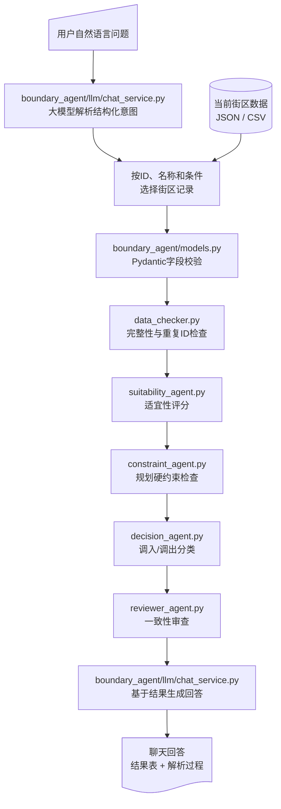

# 城镇开发边界地块识别智能体 Demo：新手代码导读

> **归档说明**：本文描述旧版 Streamlit 实现，文件路径和界面结构可能已过时。当前项目入口与目录请以根目录 `README.md` 和 `docs/项目目录说明.md` 为准。
>
> 适合对象：刚开始学习 Python、LangChain/LangGraph 和 Streamlit，希望知道“每个文件做什么、数据怎样流动、规则怎样得到结论”的读者。
>
> 本 Demo 是教学和流程验证程序，不执行 GIS 空间分析，也不代表正式规划结论。

## 1. 先用一句话理解这个项目

用户在聊天界面中用自然语言提问。程序先用大模型理解用户意图，从已经加载的 JSON/CSV 中识别目标街区，再依次进行输入校验、适宜性评分、规划约束检查、调入/调出判断和结果审查，最后由大模型基于结构化结果回答。

这里有一个非常重要的设计原则：

- **规则程序负责结论**：分数、硬约束、调入/调出类别由确定性 Python 代码产生。
- **大模型负责解释**：大模型只能填写 `ai_explanation`，不能修改规则结论。

这样做比“把所有数据直接交给大模型，让它自由判断”更容易复现、测试和追溯。

## 2. 整体工作流



`boundary_agent/workflow/graph.py` 使用 LangGraph 把这些步骤连接起来。当前版本的节点按固定顺序执行，没有真正的条件回退或循环。

## 3. 项目目录怎么读

```text
boundary_agent_demo/
├─ app.py                         # Streamlit网页入口
├─ cli_demo.py                    # 命令行演示
├─ model_settings.py              # 用户直接编辑的模型参数
├─ boundary_agent/                # Python业务包
│  ├─ config.py                   # 读取业务配置
│  ├─ io.py                       # JSON/CSV解析
│  ├─ models.py                   # Pydantic数据模型
│  ├─ paths.py                    # 统一项目路径
│  ├─ storage.py                  # SQLite结果保存
│  ├─ llm/
│  │  ├─ client.py                # 统一创建模型客户端
│  │  ├─ chat_service.py          # 意图解析和对话回答
│  │  └─ explainer.py             # 批量结果解释
│  └─ workflow/
│     ├─ graph.py                 # LangGraph流程编排
│     ├─ rules.py                 # 评分和约束规则
│     └─ agents/                  # 五个职责节点
├─ config/settings.yaml           # 权重、阈值和尺度
├─ data/sample/blocks.json        # 三个示例街区
├─ prompts/                       # 预留提示词模板
├─ docs/                          # 项目文档
├─ tests/                         # 自动化测试
└─ outputs/                       # JSON、SQLite与运行日志
```

这次结构优化遵循三个原则：根目录只放启动和用户配置；可复用业务代码全部进入 `boundary_agent` 包；配置、数据、文档、测试和输出按用途分目录。`paths.py` 是程序路径的唯一来源，`llm/client.py` 是模型客户端的唯一创建入口。

建议的阅读顺序是：

1. `data/sample/blocks.json`：先看输入长什么样。
2. `boundary_agent/models.py`：看程序接受哪些字段。
3. `config/settings.yaml`：看规则参数。
4. `boundary_agent/workflow/rules.py`：理解评分怎么算。
5. `boundary_agent/workflow/agents/`：理解每个智能体怎样包装规则。
6. `boundary_agent/workflow/graph.py`：理解节点怎样连接。
7. `boundary_agent/llm/chat_service.py`：理解自然语言怎样变成街区分析任务。
8. `app.py`：理解聊天页面怎样调用对话智能体。
9. `boundary_agent/llm/explainer.py`：最后再看批量模式的大模型解释。

## 4. 输入数据：`data/sample/blocks.json`

一个街区就是一个 Python 字典，也就是 JSON 中的一个对象，例如：

```json
{
  "block_id": "WH2025_DEMO001",
  "block_name": "边界外高适宜街区",
  "inside_boundary": false,
  "area_km2": 1.25,
  "poi_industry": 34,
  "poi_transport": 18,
  "dem_relief": 4.0,
  "road_density": 7.5,
  "ecological_redline": false,
  "permanent_farmland": false
}
```

重点字段：

| 字段 | 含义 | 示例 |
|---|---|---|
| `block_id` | 街区唯一编号，必填 | `WH2025_DEMO001` |
| `inside_boundary` | 当前是否在开发边界内，必填 | `false` |
| `area_km2` | 街区面积，平方千米 | `1.25` |
| `poi_*` | 不同类别的POI数量或密度 | `34` |
| `dem_relief` | 地形起伏度 | `4.0` |
| `pop_density` | 人口密度 | `null` 表示缺失 |
| `road_density` | 道路密度 | `7.5` |
| `construction_ratio` | 建设用地比例，范围0～1 | `0.65` |
| `ecological_redline` | 是否涉及生态保护红线 | `false` |
| `permanent_farmland` | 是否涉及永久基本农田 | `false` |
| `disaster_risk` | 灾害风险 | `低`、`中`、`高`或`禁止建设` |

`null` 与数字 `0` 含义不同：

- `null`：不知道、尚未提供，程序会降低完整度。
- `0`：已经确认该指标确实为零，可以参加计算。

## 5. 数据模型：`boundary_agent/models.py`

这个文件使用 Pydantic 定义程序中的“标准数据形状”。可以把 Pydantic 理解为负责验收数据的门卫。

### 5.1 `BlockInput`

```python
class BlockInput(BaseModel):
    block_id: str = Field(min_length=1)
    inside_boundary: bool
    area_km2: float | None = Field(default=None, gt=0)
```

含义如下：

- `block_id: str`：必须是字符串。
- `inside_boundary: bool`：必须提供真/假值，没有默认值，所以是必填字段。
- `float | None`：可以是小数，也可以缺失。
- `gt=0`：有数值时必须大于0。
- `ge=0, le=1`：有数值时必须在0到1之间。

`model_config = ConfigDict(extra="allow")` 表示输入中出现未定义的额外字段时不会报错。这方便接收更丰富的街区属性，但这些额外字段不会自动进入当前评分公式。

`strip_id` 校验器会去掉 `block_id` 两端空格，并阻止空编号。

### 5.2 过程结果模型

- `ValidationResult`：输入检查结果。
- `SuitabilityResult`：分维度得分、总分、完整度和置信度。
- `ConstraintResult`：硬约束、风险和缺失约束。
- `BlockDecision`：最终地块类别及建议。
- `ReviewResult`：审查是否通过。
- `TaskOutput`：一次任务的完整输出。

使用这些模型的好处是：如果某个节点输出了错误类型或越界数值，程序会尽早报错，而不是把错误一直传到最后。

## 6. 配置文件：`config/settings.yaml`

把权重和阈值放在 YAML 中，可以修改规则而不改 Python 源码。

### 6.1 `thresholds`

```yaml
thresholds:
  primary_inclusion: 80
  secondary_inclusion: 65
  exclusion: 40
  minimum_completeness: 0.60
  minimum_confidence: 0.60
```

- 边界外街区达到80分，并满足更严格完整度要求，可判为“一级优先调入”。
- 边界外街区达到65分，可判为“二级优先调入”。
- 边界内街区低于40分且风险高，可判为“建议调出”。
- 完整度或置信度不足时，会标记需要人工复核。

### 6.2 `weights`

```yaml
weights:
  traffic: 0.25
  terrain: 0.10
  infrastructure: 0.20
  urban_form: 0.10
  industry: 0.25
  population: 0.05
  landuse: 0.05
```

交通和产业各占25%，人口和土地利用各占5%。这些权重目前只是 Demo 参数，不代表正式规划权重。

### 6.3 `scales`

`scales` 把原始指标换算成0～100分。例如：

```yaml
road_density_high: 8.0
```

当道路密度为4时，简单换算结果是 `4 / 8 × 100 = 50` 分；达到或超过8时，由 `_cap()` 截断为100分。

## 7. 输入解析：`boundary_agent/io.py`

### 7.1 `parse_json()`

它允许两种 JSON：

```json
[{"block_id": "A", "inside_boundary": false}]
```

或者：

```json
{"blocks": [{"block_id": "A", "inside_boundary": false}]}
```

最后都转换成 `list[dict]`，即“由多个街区字典组成的列表”。

### 7.2 `parse_csv()` 与 `coerce()`

CSV读取后所有单元格最初都是字符串。`coerce()` 会尝试转换：

- `待确认`、`未知`、`null` → `None`
- `是`、`true`、`1` → `True`
- `否`、`false`、`0` → `False`
- `12.5` → 浮点数
- `12` → 整数

注意：如果某个普通数值字段在 CSV 中写成字符串 `0`，当前通用转换会优先把它识别为布尔值 `False`。Python计算时 `False` 等价于0，通常不会立即报错，但这不是最严谨的按字段转换方式，后续可以改进。

## 8. 核心算法：`boundary_agent/workflow/rules.py`

### 8.1 两个辅助函数

```python
def _cap(value):
    return round(max(0.0, min(100.0, value)), 2)
```

无论输入多大或多小，结果都限制在0～100。

```python
def _ratio(value, high):
    return None if value is None else _cap(value / high * 100)
```

如果指标缺失就返回 `None`；否则用参考高值换算为百分制。

### 8.2 七个评价维度

`calculate_suitability()` 会尝试生成以下得分：

| 维度 | 使用字段 | 简化算法 |
|---|---|---|
| 交通 | `road_density`、`poi_transport` | 两项换算后取平均 |
| 地形 | `dem_relief` | 起伏越小得分越高 |
| 基础设施 | `poi_public` | 与参考高值比较 |
| 城市形态 | `area_km2` | 面积0.1～5平方千米得80分，否则55分 |
| 产业 | `poi_industry`、`poi_commercial` | 两项换算后取平均 |
| 人口 | `pop_density` | 与参考高值比较 |
| 土地利用 | 三种用地比例 | 比例相加后乘100 |

### 8.3 加权总分

代码的核心公式是：

```text
总分 = Σ(已有维度得分 × 该维度权重) / 已有维度权重之和
```

这里不是除以全部权重，而是除以“已有数据的权重”。因此人口缺失时，程序不会把人口当0分，而是暂时不计入总分。

这样可以避免把未知误判为很差，但也带来一个现象：数据很少的街区仍可能得到较高总分。所以程序还会单独计算完整度：

```text
完整度 = 已有维度权重之和 / 全部维度权重之和
```

最后用完整度和总分离50分的距离共同生成置信度。数据越完整、结论越明显，置信度通常越高。

### 8.4 约束检查

`check_constraints()` 检查：

- 生态保护红线；
- 永久基本农田；
- 地质灾害禁止建设区；
- 灾害风险等级；
- 是否缺少法定约束信息。

只要命中前三类硬约束之一，`hard_constraint=True`，后面的适宜性高分不能自动抵消它。

## 9. 五个“智能体”：`boundary_agent/workflow/agents/`

这里的“智能体”主要是按职责拆分的 Python 模块，并不是五个分别自由对话的大模型。

### 9.1 输入检查智能体

`data_checker.py` 检查：

- `block_id` 是否重复；
- 是否至少存在一个可用于适宜性评价的指标；
- 人口、土地利用是否缺失；
- 生态红线、永久基本农田信息是否不完整。

当前需要注意：它会生成 `valid` 和 `blocking_issues`，但 `boundary_agent/workflow/graph.py` 目前没有根据 `valid=False` 停止流程。这是一个适合下一步学习 LangGraph 条件路由的改进点。

### 9.2 适宜性评价智能体

`suitability_agent.py` 很薄，只是对每个街区调用 `calculate_suitability()`：

```python
return [calculate_suitability(block, config) for block in blocks]
```

这叫列表推导式，相当于逐个处理所有街区，并把结果放入新列表。

### 9.3 规划约束智能体

`constraint_agent.py` 同样逐个调用 `check_constraints()`。

### 9.4 地块识别智能体

`decision_agent.py` 的判断顺序非常重要：

```text
1. 有硬约束                           → 人工复核
2. 边界外 + 高分 + 高完整度           → 一级优先调入
3. 边界外 + 达到二级阈值              → 二级优先调入
4. 边界内 + 低分 + 高风险             → 建议调出
5. 其他                                → 保持现状
```

因为代码使用 `if / elif / elif`，一旦前面的条件成立，后面的条件就不再判断。这保证了硬约束优先。

`decide_all()` 先按 `block_id` 把适宜性和约束结果制作成字典，再与原街区匹配：

```python
s_map = {item.block_id: item for item in suitability_results}
c_map = {item.block_id: item for item in constraint_results}
```

这就是项目中“所有数据通过 `block_id` 关联”的实现方式。

### 9.5 结果审查智能体

`reviewer_agent.py` 检查：

- 是否绕过硬约束给出调入结论；
- 是否缺少判断依据；
- 置信度是否明显高于数据完整度。

输出状态有：

- `pass`：自动检查通过；
- `human_review`：规则没有明显冲突，但需要人工复核；
- `revise`：发现逻辑问题，应修改结论或程序。

## 10. LangGraph编排：`boundary_agent/workflow/graph.py`

### 10.1 `WorkflowState`

`WorkflowState` 是节点之间共享的数据包：

```python
class WorkflowState(TypedDict, total=False):
    task_id: str
    config: dict
    blocks: list[dict]
    suitability: list[dict]
    constraints: list[dict]
    decisions: list[dict]
    output: dict
```

每个节点从 `state` 读取需要的数据，然后返回自己新增或更新的部分。例如适宜性节点返回：

```python
{"suitability": [...]}
```

LangGraph 会把它合并回共享状态。

### 10.2 建图

```python
builder = StateGraph(WorkflowState)
builder.add_node("validate_input", validate_node)
builder.add_edge(START, "validate_input")
builder.add_edge("validate_input", "evaluate_suitability")
...
builder.add_edge("generate_report", END)
```

- `add_node()`：注册一个工作步骤。
- `add_edge()`：规定步骤执行顺序。
- `compile()`：把图编译成可以运行的对象。
- `invoke()`：提交初始状态并运行整张图。

### 10.3 `run_workflow()`

这是其他文件调用工作流的统一入口：

```python
result = run_workflow(blocks, config)
```

它会生成唯一 `task_id`，加载配置，运行全部节点，最后返回 `state["output"]`。

## 11. 大模型调用：`model_settings.py` 和 `boundary_agent/llm/explainer.py`

### 11.1 参数配置

在 `model_settings.py` 中：

```python
MODEL_CONFIG = {
    "enabled": False,
    "model": "deepseek-chat",
    "base_url": "https://api.deepseek.com",
    "api_key": "",
    "api_key_env": "DEEPSEEK_API_KEY",
    "temperature": 0.0,
    "max_tokens": 500
}
```

如果希望在 Demo 中直接显示配置，可以写：

```python
"enabled": True,
"api_key": "你的Key",
```

也可以把 `api_key` 留空，通过环境变量提供密钥。程序还兼容把以 `sk-` 开头的明文密钥直接写在 `api_key_env` 中，但从字段含义看，更推荐写入 `api_key`。

### 11.2 LangChain调用

```python
model = ChatOpenAI(**kwargs)
return model.invoke(prompt).content
```

`ChatOpenAI` 不只可以连接 OpenAI；只要服务提供兼容的接口，也可以通过 `base_url` 和模型名连接其他服务。

传给大模型的提示词明确限制：

- 只能解释给定 JSON；
- 不能修改分类、分数、约束和置信度；
- 不能编造输入中不存在的事实；
- 必须说明结果只是辅助建议。

异常会被 `try/except` 捕获，并把错误写入 `ai_explanation`，避免一次模型调用失败导致整个批次崩溃。

当前 `prompts/` 目录中的文本文件还没有被代码读取，真正使用的提示词直接写在 `boundary_agent/llm/explainer.py` 中。以后可以把提示词移到文件中，方便版本管理。

## 12. 对话智能体：`boundary_agent/llm/chat_service.py`

对话智能体是自然语言和原规则工作流之间的桥梁，主要分为五步：

1. `parse_user_intent()`：把问题解析成 `ChatIntent`。
2. `select_blocks()`：按 `block_id`、街区名称和边界内外条件选择记录。
3. `run_workflow()`：对选中的街区运行原有LangGraph规则流程。
4. 按用户请求筛选“调入”“调出”等结果。
5. `_llm_answer()`：让大模型严格基于结构化结果组织中文回答。

例如用户输入：

```text
找出建议调出的边界内街区
```

会解析为近似结构：

```json
{
  "action": "find_exclusion",
  "inside_boundary": true,
  "requested_decisions": ["建议调出"],
  "analyze_all": true
}
```

支持的意图有：查看原始街区数据、指定街区分析、调入候选查询、调出候选查询、街区比较、全部汇总和使用帮助。

例如输入 `查看全部街区数据` 或 `查看 WH2025_DEMO001 的原始属性` 时，意图为 `show_data`。程序只返回当前加载的原始字典和JSON下载按钮，不运行适宜性、约束或调入/调出分析。

如果大模型未配置或调用失败，程序会使用 `_fallback_intent()` 做关键词解析，并用 `_fallback_answer()` 输出模板回答。页面会明确显示警告，不会假装调用了大模型。

对话模式调用 `run_workflow(..., include_ai_explanations=False)`，关闭逐街区的大模型润色，然后只在最后统一调用一次大模型回答，避免街区很多时产生大量重复请求。

## 13. 页面入口：`app.py`

Streamlit 的特点是：脚本从上到下执行，每次用户操作控件时，页面脚本可能重新运行。

新版页面使用三个标签页：

- **智能对话**：主要入口，用 `st.chat_input()` 接收自然语言。
- **批量分析**：保留原来的整批规则处理和JSON下载。
- **当前数据**：检查已经加载的街区记录。

页面主要做六件事：

1. 显示标题和侧栏配置；
2. 读取内置 JSON 或用户上传文件；
3. 用户发送消息后调用 `handle_chat()`；
4. 使用 `st.session_state` 保存多轮聊天记录；
5. 展示自然语言回答、街区结果表和结构化意图；
6. 在批量模式中保存 SQLite 或下载 JSON。

```python
prompt = st.chat_input("请输入问题")
if prompt:
    turn = handle_chat(prompt, blocks, load_config())
```

`st.session_state.chat_messages` 在 Streamlit 重新运行脚本时保留历史消息。“清空对话”按钮会删除这段会话状态。

## 14. 结果保存：`boundary_agent/storage.py`

SQLite 是一个单文件数据库，不需要额外启动数据库服务。

程序创建 `tasks` 表：

```text
task_id     每次任务的唯一编号
created_at  保存时间
payload     完整结果JSON文本
```

`INSERT OR REPLACE` 表示相同 `task_id` 再次保存时覆盖该条任务记录。原始街区文件不会被修改。

## 15. 自动化测试：`tests/`

`test_workflow.py` 的五个测试检查原规则流程；`test_boundary_agent/llm/chat_service.py` 另外检查：指定街区分析、调入候选查询、两个街区比较、比较对象不足和未知街区。

原规则流程的五个测试分别检查：

1. 三个输入街区产生三个结果；
2. 生态硬约束街区不会被自动调入；
3. 边界内、高风险、低适宜街区会建议调出；
4. 最终结果能够转换为 JSON；
5. 默认关闭大模型时，`ai_explanation` 为空。

运行：

```powershell
cd "E:\VscodeMyPrograma\GEO_Dataanalysis\城镇开发边界\boundary_agent_demo"
E:\miniconde\envs\langchain_env\python.exe -m unittest discover -s tests -v
```

测试的价值是：修改权重、规则或代码后，可以快速发现是否破坏原有逻辑。

## 16. 如何运行

### 15.1 启动网页

一定要先进入含有 `app.py` 的目录：

```powershell
cd "E:\VscodeMyPrograma\GEO_Dataanalysis\城镇开发边界\boundary_agent_demo"
E:\miniconde\envs\langchain_env\python.exe -m streamlit run app.py
```

浏览器打开：`http://localhost:8501`

不要使用 `python app.py`，因为 Streamlit 应用必须由 Streamlit 命令启动。

### 15.2 运行命令行版本

```powershell
E:\miniconde\envs\langchain_env\python.exe cli_demo.py
```

结果写入 `outputs/decisions.json`。

### 15.3 安装依赖

```powershell
E:\miniconde\envs\langchain_env\python.exe -m pip install -r requirements.txt
```

项目固定了 `starlette==0.48.0`。这是因为当前 Streamlit 与 Starlette 1.x 的 `GZipResponder` 接口不兼容；不要单独把 Starlette 升级到1.x。

## 17. 跟踪一个街区的完整旅程

以 `WH2025_DEMO001` 为例：

1. `app.py` 读取 `blocks.json`，用户在聊天框输入“分析 WH2025_DEMO001”。
2. `boundary_agent/llm/chat_service.py` 用大模型解析意图并定位该 `block_id`。
3. `boundary_agent/workflow/graph.py` 用 `BlockInput.model_validate()` 转为 Pydantic 对象。
4. `data_checker.py` 发现人口和土地利用缺失，但仍有交通、产业、地形等可用数据。
5. `boundary_agent/workflow/rules.py` 计算交通、地形、设施、形态、产业等维度得分。
6. 缺失的人口和土地利用不自动填0，而是降低完整度。
7. `constraint_agent.py` 没有发现生态红线、基本农田和禁止建设区。
8. `decision_agent.py` 根据“边界外 + 高适宜性 + 无硬约束”生成调入候选类别。
9. `reviewer_agent.py` 检查结论有没有绕过硬约束。
10. `report_node` 汇总结构化结果。
11. `boundary_agent/llm/chat_service.py` 让大模型基于该结果回答用户，并在页面展示结果表和解析过程。

## 18. 当前 Demo 的局限

理解局限和理解代码同样重要：

- 没有执行矢量叠加、缓冲区、栅格统计等 GIS 处理。
- 没有训练或调用真实 XGBoost 模型。
- 没有计算 SHAP 值；当前“判断依据”来自规则得分排序。
- `config/settings.yaml` 中的 `hard_constraints` 开关目前没有实际参与代码判断。
- `workflow.max_retries` 和 `require_human_approval` 目前没有用于 LangGraph 路由。
- 输入检查失败后，流程目前不会自动停止。
- 结果审查发现 `revise` 后，不会自动退回决策节点重算。
- 土地利用得分只是三类比例简单相加，不能替代正式评价模型。
- 置信度是 Demo 公式，不是统计学概率。
- 意图解析只向大模型提供前500条街区目录，正式系统应使用数据库或向量检索处理超大目录。
- 当前对话历史用于页面展示，但每次意图解析没有把全部历史消息发送给大模型，因此指代“它”“上一个街区”的多轮理解仍有限。

这些不是隐藏错误，而是从简单 Demo 逐步升级为正式系统时需要实现的功能。

## 19. 推荐的新手练习顺序

### 练习1：修改阈值

把 `secondary_inclusion` 从65改成70，运行测试和 Demo，观察分类变化。

### 练习2：添加一个街区

复制 `blocks.json` 中的一条记录，修改 `block_id` 和指标，观察结果。故意使用重复 `block_id`，查看输入检查结果。

### 练习3：添加输出字段

在 `BlockDecision` 中增加 `suitability_level`，然后在 `decision_agent.py` 中赋值。

### 练习4：做真正的条件路由

在 LangGraph 中加入条件边：当 `validation.valid=False` 时直接进入错误报告节点，不继续评分。

### 练习5：把提示词移出代码

让 `boundary_agent/llm/explainer.py` 读取 `prompts/` 中的文本文件，并用占位符插入街区决策 JSON。

### 练习6：接入 XGBoost 和 SHAP

保留现有输入检查、约束和审查节点，只把 `suitability_agent.py` 的规则评分替换为：

```text
街区属性 → XGBoost预测概率 → SHAP解释 → SuitabilityResult
```

这样不用推翻整个架构，只替换一个节点。

## 20. 遇到问题时怎么排查

### 页面提示 `File does not exist: app.py`

当前目录不对。先 `cd` 到 `boundary_agent_demo`。

### 使用 `python app.py` 出现 `missing ScriptRunContext`

启动方式不对。使用：

```powershell
python -m streamlit run app.py
```

### 页面返回500，并出现 `GZipResponder` 错误

检查：

```powershell
python -m pip show streamlit starlette
```

本项目应使用 `starlette==0.48.0`，然后重启 Streamlit。

### 大模型没有解释

依次检查：

1. `enabled` 是否为 `True`；
2. `api_key` 是否填写，或环境变量是否存在；
3. `model` 和 `base_url` 是否与服务商一致；
4. 页面展开结果中的 `ai_explanation` 是否包含错误信息。

### 修改代码后结果没有变化

先确认修改的是当前运行目录下的文件，再停止旧服务并重新启动。浏览器必要时使用 `Ctrl + Shift + R` 强制刷新。

## 21. 最后建立一个正确的心智模型

你可以把整个项目理解为一条装配线：

```text
自然语言问题
  ↓ 大模型意图解析
目标街区记录
  ↓ Pydantic验收
标准街区对象
  ↓ 规则评分
适宜性结果
  ↓ 约束检查
可行性结果
  ↓ 决策规则
候选类别
  ↓ 自动审查
可信度与风险提示
  ↓ 大模型基于结果回答
对话式中文分析
```

LangGraph 管理“先做什么、后做什么”；Pydantic 管理“数据应该长什么样”；规则引擎管理“分数怎么算”；Streamlit 管理“用户如何操作和查看”；LangChain 管理“怎样调用大模型”。把这五个职责分清后，代码就不会显得杂乱。

